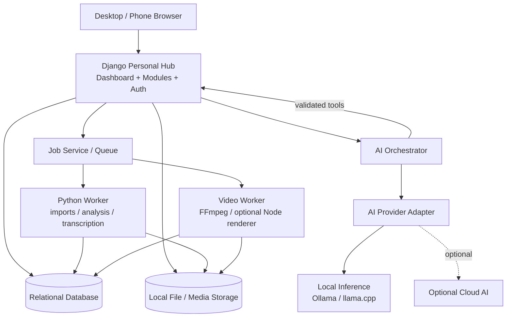
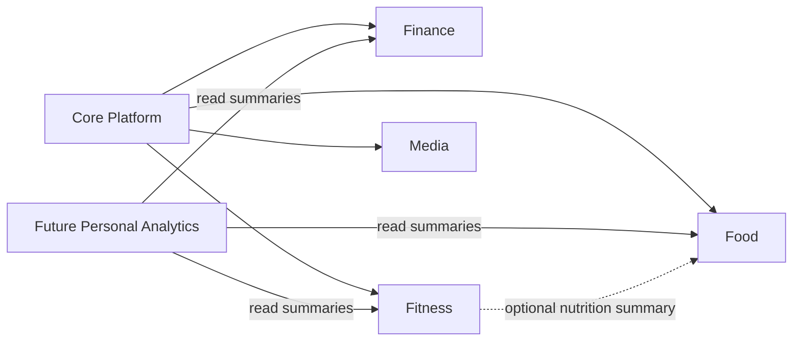
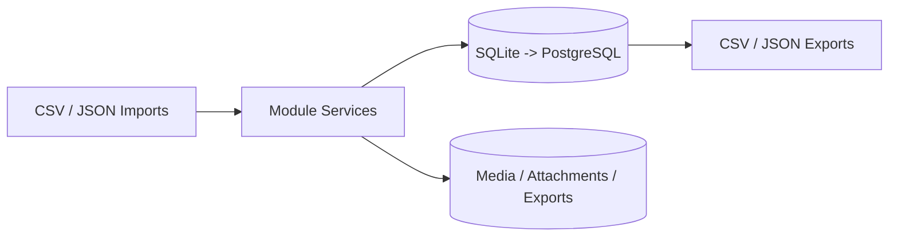
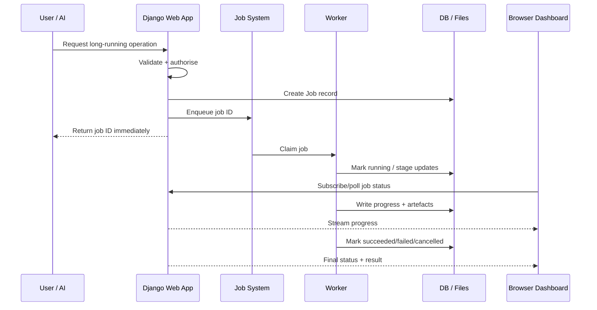
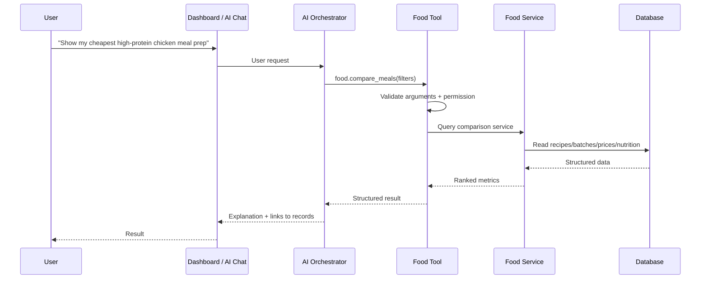
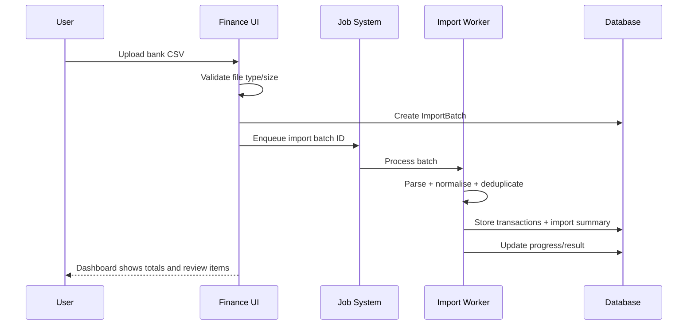
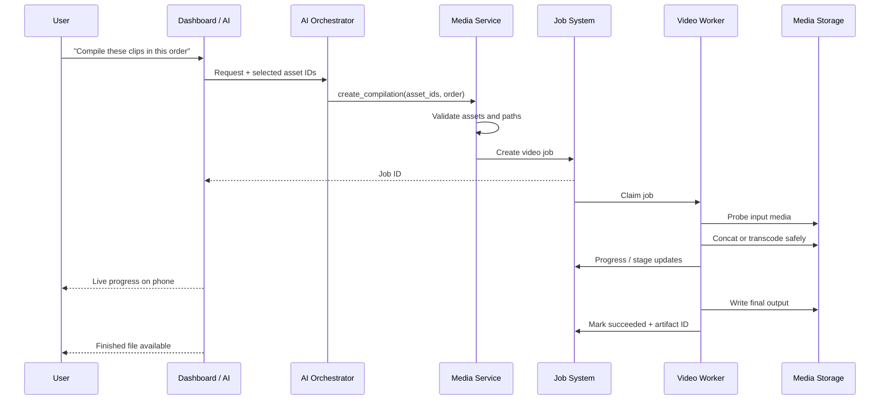

# Personal AI Homelab Platform — Living Project Design

> **Document status:** Living design document — early research and design  
> **Version:** 0.1.0  
> **Last updated:** 2026-10-11  
> **Research snapshot:** 2026-10-11  
> **Intended path:** `docs/project-design.md`  
> **Implementation status:** Pre-prototype / brainstorming  

## Status legend

This document intentionally separates commitments from ideas.

| Status | Meaning |
|---|---|
| **Confirmed** | A requirement, constraint, or principle that is currently intended to guide the project. |
| **Proposed** | The current recommended direction, but still open to challenge or replacement. |
| **Under Consideration** | A plausible option that needs research, experimentation, or a later decision. |
| **Future Idea** | Deliberately outside the near-term scope; recorded so it is not lost. |
| **Implemented** | Exists in working code and has been tested. |
| **Deprecated** | Previously considered or implemented but no longer recommended. |

> **Maintenance rule:** A suggestion in a conversation does **not** become a confirmed design decision merely because it appears in this document. Only explicitly accepted decisions should move to **Confirmed** or **Implemented**.

---

# 1. Project overview and vision

## 1.1 Vision

**Confirmed** — Build a local-first, modular, AI-enhanced personal homelab platform that acts as a central place for personal applications, information, automation, long-running jobs, and experiments.

The system should be valuable even if every AI service is turned off. AI should sit **above** normal application functionality and provide natural-language interaction, analysis, planning, recommendations, and controlled tool execution rather than becoming a mandatory dependency for basic operations.

Initial example domains include:

- food, recipes, nutrition, meal preparation, grocery cost analysis;
- personal finance and budgeting;
- AI-assisted video editing and content creation;
- fitness and activity tracking;
- system monitoring and other homelab utilities;
- future modules that have not yet been designed.

The long-term goal is not simply to host several unrelated web apps. It is to create a personal software platform with common conventions for data, jobs, tools, AI access, security, navigation, observability, and cross-module integration.

## 1.2 Guiding principles

1. **Local-first, not local-only.** Personal data and ordinary processing should remain local where practical, while optional cloud services may be used deliberately when they provide a meaningful capability advantage.
2. **AI is an enhancement.** Core features should remain deterministic and usable without an LLM.
3. **Modular boundaries matter more than deployment boundaries.** A module can be well separated in code without becoming a separate microservice or container.
4. **Start simple and earn complexity.** Introduce queues, service separation, vector databases, MCP servers, or agent frameworks only when a demonstrated use case justifies them.
5. **Prefer deterministic tools for deterministic work.** For example, an LLM may plan a video edit, while FFmpeg or another renderer performs the actual transformation.
6. **Use one source of truth for structured data.** CSV and JSON should be good import/export formats, not an accidental database for interconnected application state.
7. **Make expensive resources explicit.** GPU inference, transcription, video encoding, and large-file processing should be scheduled so they do not compete unpredictably for the RTX 4060.
8. **Build useful vertical slices.** Each development phase should end with a feature that can be demonstrated and used.
9. **Preserve replaceability.** AI models, inference runtimes, job backends, storage engines, and specialised workers should be replaceable behind stable interfaces where doing so is inexpensive.
10. **Keep historical rationale.** Rejected ideas and superseded decisions should remain discoverable through ADRs and the revision log.

---

# 2. Goals and non-goals

## 2.1 Goals

| Goal | Status | Notes |
|---|---|---|
| Modular applications with clear boundaries | **Confirmed** | Food, Finance, Media, Fitness, etc. should not become one tightly coupled codebase. |
| Central web dashboard | **Confirmed** | Navigation, status, jobs, AI interaction, module summaries, and settings. |
| Responsive phone access | **Confirmed** | Mobile browser first; native mobile app is not required initially. |
| Local AI inference | **Confirmed** | Start with free local models and evaluate quality on real tasks. |
| Optional cloud AI | **Proposed** | Used selectively through the same provider abstraction when local models are insufficient. |
| Long-running jobs | **Confirmed** | Required for transcription, imports, analysis, video processing, and later automation. |
| Tool-based AI actions | **Confirmed** | AI should invoke narrow application capabilities rather than write directly to databases. |
| Self-hosting | **Confirmed** | Initial host is the Windows desktop; deployment should remain portable. |
| Incremental development | **Confirmed** | Avoid months of infrastructure before usable features exist. |
| Exportability | **Confirmed** | Structured data should be exportable in ordinary formats such as CSV/JSON. |
| Observability | **Proposed** | Job history, logs, tool calls, failures, and system status should be visible. |

## 2.2 Non-goals for the initial system

- **No microservices-by-default.** Separate deployment should be introduced for technical reasons, not as an architectural aesthetic.
- **No public internet exposure by default.** Remote access should initially use a private network solution such as Tailscale rather than router port forwarding.
- **No autonomous financial transactions.** The Finance module initially analyses imported data; it does not transfer money, trade, or initiate payments.
- **No fully autonomous destructive AI.** Deleting data, overwriting media, bulk modifications, or external side effects should require approval or stronger controls.
- **No requirement for a native mobile app.** A responsive web UI is the first target.
- **No requirement for RAG or a vector database.** Add semantic retrieval only when a concrete information-retrieval problem appears.
- **No requirement for multi-agent orchestration.** A single orchestrator with well-designed tools is the default starting point.
- **No requirement to automate an NLE such as DaVinci Resolve.** Deterministic, editor-independent pipelines should work first.
- **No expectation that an 8 GB GPU can run every interesting model simultaneously.** Resource scheduling and smaller models are part of the design.

---

# 3. Confirmed requirements, assumptions, and open questions

## 3.1 Confirmed requirements and constraints

| Area | Current requirement / constraint |
|---|---|
| Host | Windows desktop PC initially. |
| GPU | NVIDIA RTX 4060 with 8 GB VRAM. |
| RAM | 32 GB DDR4. |
| CPU | Intel Core i9. |
| AI cost | Begin with free/local inference; optional paid APIs may be introduced later. |
| Dashboard | Accessible from desktop and phone. |
| Data | Personal data should remain local by default. |
| AI | AI should be replaceable and should operate through controlled tools. |
| Video | Rendering need not be performed by the LLM itself. |
| DaVinci | Only the free edition is currently available; project design must not depend on Studio-only capabilities. |
| Development style | Solo-developer friendly, documented, incremental, and suitable for long-term learning. |

## 3.2 Working assumptions

These assumptions should be revisited when they stop being true.

- **Proposed assumption:** The platform initially has one human user.
- **Proposed assumption:** Availability requirements are modest; the desktop may be turned off and the platform does not initially need 24/7 uptime.
- **Proposed assumption:** Most structured datasets are small to medium by server standards; video files are the main storage-heavy workload.
- **Proposed assumption:** Local file paths are acceptable for media in the first deployment, with database records storing metadata rather than video blobs.
- **Proposed assumption:** The project can tolerate occasional manual recovery while infrastructure is immature, provided data is backed up.
- **Proposed assumption:** Phone access primarily needs dashboards, forms, AI requests, job monitoring, and light administration rather than full video editing.
- **Proposed assumption:** Only a small number of GPU-heavy jobs need to run concurrently; in practice GPU concurrency may be deliberately limited to one heavy job at a time.

## 3.3 Important open questions

- Should the first persistent database be SQLite or PostgreSQL?
- Should the first web UI use Django templates plus light JavaScript/HTMX, or a separate React frontend?
- Should the first production-style job queue use Celery + Redis, a Django 6 Tasks backend, or a simpler custom worker?
- Is MCP useful immediately, or should internal typed tools be built first and later exposed through MCP?
- Which local model provides the best combination of tool reliability, latency, multimodal capability, and memory use on the RTX 4060?
- Should local inference be served by Ollama, llama.cpp, or another runtime after initial experiments?
- Does DaVinci Resolve Free expose enough automation in the current installed version to justify an integration, or should Resolve remain a manual finishing step?
- Is the Windows host sufficient long-term, or should a later always-on Linux server become the control plane while the desktop remains a GPU worker?

---

# 4. Proposed functional requirements

The IDs below are useful for discussion and testing; they are not a complete specification.

## 4.1 Platform-level requirements

| ID | Requirement | Priority | Status |
|---|---|---:|---|
| PLAT-01 | Show enabled modules in one dashboard. | MVP | **Proposed** |
| PLAT-02 | Provide consistent navigation and settings. | MVP | **Proposed** |
| PLAT-03 | Allow modules to expose safe application actions as tools. | MVP | **Proposed** |
| PLAT-04 | Provide an AI chat/request interface that can call approved tools. | MVP | **Proposed** |
| PLAT-05 | Record long-running jobs with status, progress, result, error, timestamps, and cancellation state. | MVP | **Proposed** |
| PLAT-06 | Display running and historical jobs. | MVP | **Proposed** |
| PLAT-07 | Support data import/export using ordinary formats. | MVP | **Confirmed** |
| PLAT-08 | Allow remote access from a phone over a secure private connection. | MVP+ | **Confirmed** |
| PLAT-09 | Support scheduled work and recurring automation. | Later | **Proposed** |
| PLAT-10 | Allow modules to publish or consume stable cross-module services. | Later | **Confirmed principle** |

## 4.2 AI requirements

| ID | Requirement | Priority |
|---|---|---:|
| AI-01 | Select model/provider without changing domain code. | MVP |
| AI-02 | Support structured tool calls with schema validation. | MVP |
| AI-03 | Log model/provider and tool activity for debugging. | MVP |
| AI-04 | Require approval for sensitive write/destructive tools. | MVP |
| AI-05 | Distinguish read-only, write, external-side-effect, and destructive tools. | MVP |
| AI-06 | Support local models first and cloud providers optionally. | MVP+ |
| AI-07 | Route vision tasks only to models/providers that actually support images. | Later |
| AI-08 | Allow background AI workflows to report progress through the job system. | Later |

## 4.3 Data and import requirements

- Imports must be repeatable or traceable through an `ImportBatch`-style record where relevant.
- Original imported files should be retained or hash-addressed until the import has been verified.
- AI-generated values should be distinguishable from user-entered or source-imported values when that distinction matters.
- Nutritional values and financial categorisation should retain provenance where practical.
- Media files should remain files; large binary data should not be placed directly in the relational database without a specific reason.

---

# 5. Non-functional requirements

| Area | Requirement / target |
|---|---|
| **Privacy** | Personal data remains local by default; cloud AI receives only data deliberately selected for a task. |
| **Maintainability** | Domain logic should be callable independently of HTTP views and AI prompts. |
| **Portability** | Avoid Windows-only assumptions in domain code; isolate OS-specific paths/process invocation. |
| **Recoverability** | Database and important configuration must have a documented backup/restore path. |
| **Observability** | Failures should be diagnosable from structured logs, job records, and agent/tool traces. |
| **Security** | No arbitrary shell access for the AI; file and command tools are allow-listed and scoped. |
| **Performance** | Ordinary dashboard operations should not wait for LLM inference or heavy video tasks. |
| **Resource control** | GPU-heavy work should be queued or mutually exclusive when required by VRAM limits. |
| **Usability** | Common actions should remain available through normal forms/buttons instead of requiring chat. |
| **Testability** | Tool handlers and domain services should be testable without a real LLM. |
| **Data ownership** | Each module owns its main tables and writes to them through its own service layer. |
| **Evolvability** | Service/API boundaries should permit later extraction into processes or services without requiring that extraction now. |

---

# 6. Application modules and potential features

## 6.1 Food, nutrition, and meal preparation

### Scope

**Proposed first major module.** It is small enough to finish, immediately useful, and exercises relational modelling, imports, calculations, dashboards, AI tools, and mobile UI.

### Candidate entities

| Entity | Purpose |
|---|---|
| `Ingredient` | Generic ingredient concept, e.g. chicken breast, basmati rice. |
| `Product` | Specific purchasable item/brand/package with pack size and nutrition label. |
| `PriceObservation` | Price paid or observed for a product, store, date, normal/reduced price. |
| `Recipe` | Reusable preparation with servings and instructions. |
| `RecipeIngredient` | Quantity/unit linking a recipe to an ingredient or product. |
| `MealPrepBatch` | A particular cooking session with actual quantities, cost, yield, and date. |
| `Portion` | Optional explicit portion record if portions vary. |
| `NutritionSource` | Provenance for nutrition values: label, public dataset, estimate, manual entry. |
| `ShoppingList` | Planned purchases generated manually or from selected recipes. |

### Useful calculations

- total batch cost;
- cost per serving;
- calories and protein per serving;
- grams of protein per euro;
- euro per 100 g of protein;
- calories per gram of protein;
- cost per day/week;
- normal price versus reduced price comparisons;
- estimated active preparation time per serving;
- optional convenience score, explicitly labelled subjective rather than pretending to be objective.

### Design note: homemade versus ready-meal comparisons

A reduced ready meal should not overwrite its normal price. `PriceObservation` should retain both the actual purchase price and, when known, a reference/normal price. This makes it possible to answer two different questions:

1. “Was this discounted meal good value **today**?”
2. “Is this product normally a better value than meal prep?”

### Data sources

**Proposed:** Use manual entry and package-label data first. Public food datasets or external nutrition APIs can be added as enrichment sources, but should not become a hard dependency.

**Future Idea:** Image-based extraction from labels and receipts. Extracted values should be shown for confirmation before becoming trusted structured data.

### AI tools — examples

- `food.search_recipes(filters)` — read-only;
- `food.get_recipe(recipe_id)` — read-only;
- `food.calculate_batch(batch_draft)` — read-only calculation;
- `food.create_meal_prep_batch(payload)` — write, confirmation for large inferred changes;
- `food.compare_meals(meal_ids, metrics)` — read-only;
- `food.generate_shopping_list(recipe_ids, servings)` — creates a draft;
- `food.suggest_meals(constraints)` — AI-assisted recommendation using deterministic stored data.

The AI should call application services; it should not issue SQL.

---

## 6.2 Personal finance and budgeting

### MVP scope

- import bank/exported transaction CSVs;
- map source columns into a canonical transaction format;
- categorise transactions manually and by deterministic rules;
- track monthly income, expenses, savings, and budgets;
- display category and time-period trends;
- identify likely recurring costs;
- export processed data;
- generate natural-language summaries through AI.

### Candidate entities

| Entity | Purpose |
|---|---|
| `Account` | Logical account/source, not necessarily a live banking connection. |
| `Transaction` | Canonical transaction record. |
| `Category` | Hierarchical or flat spending category. |
| `CategorisationRule` | Deterministic merchant/text rule. |
| `Budget` | Target amount by category and period. |
| `ImportBatch` | Traceability for a CSV import. |
| `RecurringSeries` | Optional detected/confirmed recurring expense pattern. |

### Important safety boundary

**Confirmed for early phases:** Finance is read/import/analyse only. No AI tool should initiate bank transfers, trades, card actions, or other external financial transactions.

### AI role

Use AI for ambiguous categorisation suggestions, summaries, anomaly explanation, and natural-language queries. Prefer deterministic rules for merchants that have already been confirmed.

---

## 6.3 AI-assisted video editing and content creation

### Principle

**Proposed:** The AI is the planner/orchestrator; deterministic tools perform media operations.

The system should represent an edit as structured data rather than asking an LLM to directly manipulate every frame. A future `EditPlan` could contain cuts, source ranges, overlays, crop/reframe instructions, captions, audio operations, and generated graphic assets.

### Candidate entities

| Entity | Purpose |
|---|---|
| `VideoProject` | Project-level metadata and desired output. |
| `MediaAsset` | Video/audio/image/subtitle source with path, duration, codec metadata, hash. |
| `TranscriptSegment` | Timestamped speech. |
| `DetectedSegment` | Silence, scene, reaction, highlight candidate, etc. |
| `EditPlan` | Versioned structured edit instructions. |
| `RenderArtifact` | Produced proxy, preview, subtitle file, final render, thumbnail, etc. |
| `VideoJob` | Link to the common job system and processing stage. |

### Recommended capability sequence

1. inspect media metadata with FFprobe;
2. concatenate compatible clips;
3. show progress and produce an output artifact;
4. introduce safe transcoding when streams are incompatible;
5. extract/transcribe audio;
6. detect silence and scene boundaries;
7. construct a reviewable edit plan;
8. apply simple cuts and webcam placement;
9. add subtitles/captions;
10. add reusable overlays/effects;
11. experiment with highlight detection and more subjective AI editing.

### Technology roles

| Technology | Potential role | Current view |
|---|---|---|
| **FFmpeg / FFprobe** | Media inspection, concat, trim, transcode, crop, scale, overlay, audio filters, final encoding | **Proposed core** — deterministic and editor-independent. |
| **faster-whisper / Whisper** | Local speech transcription and timestamps | **Proposed experiment** — suitable for an 8 GB-class GPU with model/precision choices tested locally. |
| **Remotion** | Programmatic React-based compositions, captions, intros, animated graphics, overlays | **Under Consideration** — useful as a graphics/composition layer, not necessarily the primary long-form cutter. |
| **HyperFrames** | Deterministic HTML-to-video rendering designed with agent workflows in mind | **Under Consideration** — promising for generated motion graphics; ecosystem/maturity should be tested before becoming a dependency. |
| **DaVinci Resolve Free** | Manual review/final finishing; possible timeline interchange or automation experiment | **Under Consideration** — do not make MVP depend on external scripting until the installed free edition is verified experimentally. |
| **OpenCV / scene tools** | Frame analysis, tracking, computer-vision utilities | **Later** — introduce only for concrete detection/reframing needs. |

### DaVinci Resolve stance

The project should not assume Studio-only features or undocumented automation behaviour. A safe first design is:

- generate an ordinary finished file and/or interchange artefacts where practical;
- use Resolve Free manually for final corrections;
- run a dedicated proof-of-concept against the installed Resolve version before creating any hard dependency on its scripting APIs.

### First video milestone

**Acceptance target:** Given 2–5 local gaming clips and an explicit order, the platform creates a job, verifies input files, concatenates or safely transcodes them, reports progress in the dashboard, and records the final output path and result.

No LLM is required for this milestone.

---

## 6.4 Fitness and personal tracking

**Future Idea / later module.**

Candidate entities:

- `WorkoutSession`;
- `Exercise`;
- `ExerciseSet`;
- `BodyMetric` (weight, measurements);
- `ActivitySummary` (steps/activity imported manually or from a future integration);
- `TrainingPlan`.

A higher-level progress view may consume read-only summaries from both Food and Fitness without writing directly into either module’s tables.

### Cross-module rule

Prefer:

`FitnessProgressService -> FoodSummaryService + WorkoutSummaryService`

rather than:

`FitnessProgress -> imports Food ORM models and writes arbitrary queries everywhere`.

The first approach keeps the data model evolvable and makes later service extraction possible.

---

## 6.5 Future modules

Record without prioritising:

- system/performance monitoring;
- personal analytics and reporting;
- file/media library management;
- home automation integrations;
- household inventory;
- personal knowledge/document search;
- notifications and reminders;
- homelab service health dashboard;
- backups/status management;
- additional creator tooling.

These should not block the Food → Finance → Jobs → Video path.

---

# 7. Architectural alternatives and trade-offs

## 7.1 Alternative A — Modular monolith

**Shape:** One Django application/deployment, multiple domain apps, one relational database, in-process service calls, optional worker process.

### Advantages

- lowest operational complexity;
- one authentication/session model;
- easy database transactions;
- easiest debugging for a solo developer;
- fast development of cross-module UI;
- module boundaries can still be enforced in code.

### Disadvantages

- GPU/video workloads do not belong inside web request processes;
- careless imports can create tight coupling;
- a failure or dependency conflict can affect the whole application;
- specialised Node/video components become awkward if forced into the same process.

### Suitability

Very strong for the central control plane, Food, Finance, Fitness, settings, AI request records, and job metadata.

---

## 7.2 Alternative B — Service-oriented / microservices

**Shape:** Food, Finance, Video, AI, and other domains each run as separate services with APIs and often separate databases/queues.

### Advantages

- strong runtime isolation;
- independent dependency stacks and scaling;
- natural fit for specialised workers;
- good learning opportunity for distributed systems.

### Disadvantages

- authentication, networking, schemas, retries, observability, deployments, and testing become significantly more complex;
- local debugging is slower;
- cross-service consistency becomes a real problem;
- many services would initially exist for organisational reasons rather than load or reliability reasons.

### Suitability

**Not recommended as the starting architecture.** It may be appropriate later for a permanently running video/AI worker, a remote GPU box, or a module with incompatible dependencies.

---

## 7.3 Alternative C — Hybrid control plane + specialised workers

**Shape:** A modular monolith owns the UI, structured data, authentication, modules, AI orchestration, and job records. Heavy or dependency-specific work runs in separate worker processes/containers and communicates through stable job/tool interfaces.

### Advantages

- keeps ordinary product development simple;
- isolates GPU/video workloads;
- supports Python and Node-based media tooling without contaminating the web process;
- allows later relocation of a worker to another machine;
- avoids requiring a network API for every module.

### Disadvantages

- requires a job/progress protocol;
- worker lifecycle and failure handling need design;
- some local-process versus network boundaries must be decided gradually.

### Recommendation

**Proposed:** Start with Alternative C, implemented as a modular monolith plus only the specialised processes actually required.

---

# 8. Recommended provisional architecture

## 8.1 High-level structure



### Interpretation

- **Django is the control plane**, not necessarily the executor of heavy work.
- Domain services live behind the web views and are reusable by AI tools, imports, scheduled jobs, and tests.
- Workers receive identifiers and structured job payloads, not arbitrary natural-language commands.
- Files remain in controlled workspace directories; the database stores paths, metadata, hashes, and state.
- Local/cloud model choice lives behind one provider interface.

## 8.2 Suggested code-level module boundaries

```text
personal-hub/
├─ apps/
│  ├─ core/          # navigation, settings, shared primitives
│  ├─ jobs/          # Job model, progress, cancellation, history
│  ├─ ai/            # provider adapters, orchestrator, tool registry
│  ├─ food/
│  ├─ finance/
│  ├─ media/
│  └─ fitness/       # later
├─ services/         # optional cross-cutting application services
├─ workers/          # worker entry points / task handlers
├─ adapters/         # external APIs, local inference, filesystem, MCP
├─ templates/
├─ static/
├─ docs/
│  ├─ project-design.md
│  └─ adr/
└─ tests/
```

This is illustrative, not prescribed. Standard Django app layout may place services inside each app (`food/services.py`, `food/tools.py`, etc.) instead of a global services directory.

## 8.3 Layering rule

**Proposed:**

```text
HTTP view / UI / AI tool / background task
                 ↓
          application service
                 ↓
       domain logic + repositories/ORM
                 ↓
              database
```

An AI tool and a normal web form should ideally call the **same** application service. That prevents two versions of the business logic from appearing.

## 8.4 Module relationship



Arrows represent explicit service/API dependencies, not permission to read another module’s tables arbitrarily.

---

# 9. Technology options and comparison tables

## 9.1 Backend framework

| Option | Strengths | Weaknesses | Recommendation |
|---|---|---|---|
| **Django** | ORM, migrations, auth, admin, forms, templates, strong monolith structure; Django 6.0 includes a Tasks API contract | Heavier than a small API framework; async/high-throughput APIs are not its main reason to choose it | **Proposed control plane**. Strong fit for many data-heavy personal modules. |
| **FastAPI** | Excellent typed API ergonomics, OpenAPI, lightweight services, async-first patterns | Less built-in product/admin/auth structure; separate frontend often required | **Under Consideration for extracted workers/services**, not necessary for every module. |
| **Node.js / Express** | Broad JS ecosystem; useful if most code becomes JavaScript/TypeScript | Rebuilds many features Django already provides; splits primary project language | **Not preferred for core**, but Node is acceptable for Remotion/HyperFrames workers. |
| **Other Python frameworks** | Could be lighter or more specialised | Additional learning and less direct benefit for current needs | Research only if a concrete limitation appears. |

### Provisional recommendation

Use Django for the central application. Do not turn FastAPI into an internal network hop merely to claim a service architecture. If the video or AI subsystem later needs an independently deployable HTTP service, FastAPI is a strong candidate there.

## 9.2 Frontend

| Option | Strengths | Weaknesses | Recommended use |
|---|---|---|---|
| **Django templates + small JS/HTMX** | One deployment, rapid forms/tables/dashboard work, minimal API duplication | Less suitable for extremely rich client-side editing | **Proposed MVP**. |
| **React + Vite** | Rich interactive components, familiar ecosystem, reusable complex UI | Separate build/app/API boundary; more state/auth plumbing | Add if dashboard interactions genuinely demand it. |
| **Next.js** | Full React framework with routing/server features | Duplicates responsibilities of Django if used as another full backend | Not justified initially. |
| **Vue/Svelte/etc.** | Good UI frameworks | Additional stack without a current requirement | Research only if desired for learning. |

**Constructive challenge:** A separate React frontend is not automatically “more scalable”. For a one-user dashboard dominated by forms, tables, charts, job status, and mobile views, server-rendered Django plus targeted interactivity is likely to produce useful features faster.

## 9.3 Structured storage

| Option | Strengths | Weaknesses | Recommendation |
|---|---|---|---|
| **SQLite** | Zero service to run, one file, excellent for early local development | Concurrent write limits and operational constraints become more relevant with many workers | **Proposed initial DB**, provided ORM usage remains portable. |
| **PostgreSQL** | Strong concurrency, indexing, data integrity, JSON support, mature operations | Extra service/container and backup configuration | **Likely long-term DB**; migrate before workload/concurrency makes SQLite awkward. |
| **CSV/JSON** | Human-readable, portable, good interchange | Weak constraints, joins, transactions, concurrency, migrations | **Import/export only**, not the platform source of truth. |
| **Vector DB** | Semantic similarity search | Adds another storage system and embedding lifecycle | **Do not add until a real semantic retrieval requirement exists.** |

### Suggested promotion triggers from SQLite to PostgreSQL

Move when one or more are true:

- multiple workers produce frequent concurrent writes;
- the app becomes an always-on service;
- job/event volume makes locking noticeable;
- deployment moves to a dedicated Linux host;
- PostgreSQL-specific capabilities solve a real problem.

## 9.4 Background processing

| Option | Strengths | Weaknesses | Recommended stage |
|---|---|---|---|
| **Synchronous/in-process** | Zero infrastructure | Blocks requests; unsafe for long work | Tiny operations only. |
| **Simple DB-backed worker process** | Easy to understand; excellent learning step; full control | Must implement leasing/retry/cancellation carefully | **Good first job-system experiment**. |
| **Django 6 Tasks API + backend** | Standard Django-facing task contract | Django provides task plumbing but not a production worker by itself; backend choice still required | **Worth evaluating** before Phase 4. |
| **Celery + Redis** | Mature retries, routing, scheduling, monitoring ecosystem | More services/configuration and operational concepts | **Strong Phase 4 candidate** when jobs become important. |
| **RQ/Dramatiq/other lightweight queues** | Simpler than Celery in some deployments | Smaller feature/ecosystem trade-offs | **Under Consideration**. |

## 9.5 Deployment

**Proposed staged approach:**

1. Start with a Python virtual environment and local processes on Windows.
2. Run local AI runtime natively where easiest.
3. Add Docker Compose for infrastructure when it removes more friction than it adds (for example PostgreSQL/Redis).
4. Do not force GPU inference/video into containers until the Windows/WSL2/NVIDIA path has been tested and provides a benefit.
5. Later, move the control plane to an always-on Linux server/NAS if desired while keeping the RTX desktop as a GPU worker.

Docker Compose remains attractive because it describes multi-container services, networks, and volumes in one configuration, but containerisation is a deployment tool rather than the project architecture itself.

---

# 10. AI model, agent, and tool integration

## 10.1 AI provider abstraction

**Proposed:** Domain code should depend on a small internal interface rather than the Ollama/OpenAI/other SDK directly.

Conceptual capabilities:

```text
AIProvider
├─ generate_text(request)
├─ generate_structured(request, schema)
├─ run_tool_loop(request, tools)
├─ supports_vision
├─ supports_tools
└─ model_metadata
```

Provider implementations might include:

- `OllamaProvider`;
- `LlamaCppProvider`;
- future cloud provider adapters;
- a test/fake provider for automated tests.

Do not force every provider to expose identical advanced features. Store a capability matrix and fail clearly when a selected model cannot perform vision or reliable tool use.

## 10.2 Local inference runtime options

### Ollama

**Proposed first runtime.** It provides a low-friction local model server and tool-capable models. This is valuable for experimentation before optimising lower-level inference.

### llama.cpp

**Under Consideration.** Useful when finer control over GGUF quantisation, GPU/CPU offload, server options, or runtime behaviour becomes important. Current `llama-server` supports OpenAI-style endpoints, schema-constrained JSON, multimodal operation, and function/tool calling.

### Other runtimes

LM Studio or other local servers may be evaluated, especially if their GUI, model management, or MCP support improves the workflow. Avoid designing domain code around a runtime-specific API.

## 10.3 Candidate local models for the current hardware

The table is a **research shortlist, not a benchmark**. Package sizes are useful hints, not the same thing as total runtime VRAM. Context KV cache, images, runtime overhead, and offload strategy also consume memory.

| Model candidate | Current published local package characteristics | Likely role on RTX 4060 8 GB | Status |
|---|---|---|---|
| **Qwen 3.5 9B** | Ollama lists multimodal/tool/thinking support; roughly 6.6–7.6 GB variants; very large advertised context ceiling | Strong candidate for primary agent experiment, but 8 GB VRAM leaves little headroom and practical context must be tested | **Proposed experiment** |
| **Qwen3 8B Q4_K_M** | Ollama package about 5.2 GB; tool/thinking support | More VRAM headroom; good baseline for tool reliability/latency comparison | **Proposed baseline** |
| **Gemma 3 4B** | Ollama package about 3.4 GB; image + text; 128K advertised context | Lightweight local vision/extraction candidate | **Proposed vision experiment** |
| **gpt-oss 20B** | Ollama package about 14 GB, tool/reasoning focused; designed to run with system memory beyond an 8 GB GPU | Heavier reasoning experiment using CPU/RAM offload; unlikely to be the everyday low-latency agent on this GPU | **Under Consideration** |

### Important model-testing rule

Do not select a model from public benchmark scores alone. Build a small **project-specific evaluation set**:

- correct tool selection;
- correct JSON/tool arguments;
- refusal to invent IDs;
- ability to ask for missing required information;
- recipe/budget query quality;
- multi-step tool loop reliability;
- image label extraction accuracy;
- latency and peak resource usage on this exact PC.

The winning model may be different for ordinary tool calls and vision work.

## 10.4 Single agent versus multiple agents

**Proposed:** Start with one central orchestrator and module-specific tools.

Why:

- the system has one user and a manageable number of domains;
- multi-agent systems introduce routing, duplicated context, more failure modes, and harder debugging;
- many “specialist agents” are better represented as deterministic workflows or prompts behind a single orchestrator.

Introduce specialised agents only when an experiment proves a benefit, for example a long-running media planner with a distinct context and tool set.

## 10.5 Internal tools versus MCP

### Recommended sequence

1. Define typed internal application tools in Python.
2. Validate their arguments with normal schemas/models.
3. Make them callable by the local orchestrator.
4. Expose selected tools through an MCP adapter if interoperability with external clients becomes useful.

This avoids making the project’s own architecture dependent on MCP while preserving an easy path to MCP.

### Why MCP remains attractive

Current MCP tool definitions are schema-described and discoverable. The specification explicitly expects input validation, access control, timeouts, logging, and user confirmation for sensitive operations. This aligns well with the project’s desired safety model.

### Tool metadata

Each internal/MCP tool should carry metadata such as:

```text
name
module
input_schema
output_schema
risk_level: read | write | external | destructive
requires_confirmation: bool
allowed_paths / scopes
expected_runtime
idempotent: bool
```

### Direct database access by AI

**Not recommended.** Prefer narrow tools such as `finance.list_transactions(...)` over `execute_sql(query)`.

Reasons:

- easier permission enforcement;
- stable semantics after schema changes;
- validation and domain invariants stay in one place;
- audit logs are understandable;
- easier to mock/test;
- greatly reduces accidental bulk modification.

## 10.6 Approval policy

Suggested defaults:

| Operation | Default policy |
|---|---|
| Read a recipe or summary | Auto-allow |
| Calculate a hypothetical budget | Auto-allow |
| Create a draft shopping list | Auto-allow, clearly marked draft |
| Add one confirmed transaction category | Allow after preview or trusted setting |
| Bulk recategorise transactions | Confirm |
| Delete database records | Confirm |
| Overwrite/delete source media | Confirm and preferably prohibit by default |
| Execute a shell command derived from model text | Prohibit; use predefined command handlers instead |
| Send personal data to a cloud model | Confirm or require an explicit configured policy |

## 10.7 Agent observability and testing

Record enough to reproduce problems:

- agent run ID;
- model/provider;
- prompt/template version;
- tools exposed;
- tool calls and validated arguments;
- tool results or safe summaries;
- errors/retries;
- elapsed time;
- token/resource metrics when available;
- user approval events.

Logs containing finance data, raw prompts, or secrets should be redactable and have a retention policy.

---

# 11. Data architecture and storage options

## 11.1 Source-of-truth strategy

**Proposed:** Relational database for structured application state; filesystem for large files; CSV/JSON for interchange.



## 11.2 Data ownership

Each module should own its main entities. Cross-module data use should happen through:

1. application service calls in the same process;
2. stable read models/DTOs;
3. an API if/when the module moves to another process;
4. events for workflows that genuinely benefit from asynchronous decoupling.

Avoid cross-module foreign keys unless the semantic relationship is fundamental and unlikely to create coupling problems. An opaque reference or shared core entity may sometimes be better.

## 11.3 Files and media

Store metadata in the database:

- stable media ID;
- path relative to a configured media root where possible;
- file size;
- hash/checksum when useful;
- duration/codec/resolution;
- created/imported timestamp;
- project association;
- generated-versus-source flag.

Never allow an AI-generated path to escape the configured workspace root. Resolve and normalise the path server-side.

## 11.4 Vector storage

**Deferred.** Potential future use cases include semantic search across notes, recipes, transcripts, or documentation. If such a feature is built, first test whether ordinary relational/full-text search is sufficient. Do not operate a dedicated vector database merely because the platform contains an LLM.

## 11.5 Backup unit

A useful backup should include:

- relational database dump/copy using the correct method for the selected DB;
- configuration excluding secrets or with secrets separately protected;
- user-created files that cannot be regenerated;
- media-project metadata and edit plans;
- optional generated artefacts depending on storage cost;
- version information needed to restore.

Large original video footage may require a different backup policy from small personal/finance data.

---

# 12. Component communication and API design

## 12.1 Communication hierarchy

Prefer the simplest mechanism that satisfies the boundary:

| Situation | Preferred first mechanism |
|---|---|
| Django view → Food domain | Direct Python application-service call |
| AI tool → Food domain | Validated Python tool handler calling the same service |
| Browser → Django | HTTP forms/JSON endpoints |
| Browser ← job progress | Server-Sent Events (SSE) or short polling initially |
| Django → long-running worker | Job queue / structured job record |
| Worker → progress | Job progress updates/events |
| Separate future service | REST/HTTP unless streaming or event semantics justify something else |
| External AI client → project tools | MCP adapter when useful |
| Scheduled task | Job scheduler enqueues the same task type used interactively |

## 12.2 REST APIs

Do not create REST endpoints for every internal function. Add endpoints when a browser, external integration, or separately deployed component needs them.

Candidate platform endpoints later:

```text
POST   /api/jobs
GET    /api/jobs/{id}
POST   /api/jobs/{id}/cancel
GET    /api/jobs/{id}/events
POST   /api/ai/runs
GET    /api/modules
```

Module endpoints can evolve as needed.

## 12.3 SSE versus WebSockets

**Proposed first choice: SSE** for job progress because updates are primarily server → browser. It is simpler than a persistent bidirectional protocol and works well for percentages, stages, log snippets, and completion notifications.

Use WebSockets later if the UI needs genuinely bidirectional low-latency interaction.

## 12.4 Events

Do not build an event bus initially. If cross-module asynchronous workflows appear, introduce an explicit event abstraction with named, versionable payloads. A transactional outbox can be considered if reliable cross-process events become important.

---

# 13. Background job and automation system

## 13.1 Core job model

A common `Job` abstraction should outlive whichever queue implementation is selected.

Suggested fields/concepts:

```text
id
job_type
module
status: queued | running | succeeded | failed | cancelled
stage
progress_current / progress_total or percent
created_at / started_at / finished_at
input_reference
result_reference
error_code / safe_error_message
cancel_requested
attempt
worker_id
resource_class: cpu | gpu | io | video
parent_job_id (optional)
```

Do not store huge payloads/results directly in the queue message. Store stable IDs pointing to database records/files.

## 13.2 Resource-aware execution

With 8 GB VRAM, the first design should assume **one heavyweight GPU workload at a time** unless testing proves otherwise.

Examples:

- unload or idle the primary LLM before a large transcription job if VRAM is insufficient;
- do not load a vision model, transcription model, and large text model concurrently by default;
- reserve video encoding/transcription as explicit GPU resource classes;
- permit CPU/IO jobs to proceed concurrently where safe.

This can initially be implemented as a single GPU worker queue/concurrency limit rather than a sophisticated scheduler.

## 13.3 Reliability behaviour

Long jobs should be:

- idempotent where possible;
- resumable by stage where practical;
- cancellable at safe checkpoints;
- explicit about whether retry is safe;
- able to distinguish user cancellation from failure;
- unable to overwrite source assets by default;
- able to leave intermediate files in a recoverable/cleanable workspace.

## 13.4 Queue evolution

**Phase A:** A simple separate Python worker that claims queued DB jobs may be sufficient for learning and the first video concat task.

**Phase B:** Before substantial automation, evaluate Django’s Tasks abstraction and established queues such as Celery + Redis. Celery is a strong candidate once retries, scheduling, routing, inspection, and multiple worker types are required.

### Important current Django note

Django 6.0’s Tasks framework defines task creation/enqueueing/tracking contracts, but Django’s built-in backends are development/testing oriented; external infrastructure still performs actual production background execution. Therefore “Django Tasks” does not eliminate the queue/worker architecture decision.

## 13.5 Task execution flow



## 13.6 Scheduling

Start simple:

- Windows Task Scheduler or a management command can trigger early recurring work;
- later, use the chosen queue’s scheduler (for example Celery Beat) if recurring jobs become numerous;
- scheduled actions should enqueue the same job types used manually rather than creating separate execution paths.

---

# 14. Frontend and dashboard design

## 14.1 Mobile-first-enough web UI

**Proposed:** Responsive web application rather than native Android/iOS app.

Benefits:

- one codebase;
- immediately accessible from desktop and phone;
- easy to add to home screen later as a PWA;
- ideal for dashboards, forms, status, and AI requests.

## 14.2 Dashboard areas

### Home

- enabled module cards;
- key Food/Finance summaries;
- currently running jobs;
- latest failures requiring attention;
- shortcut to AI assistant;
- machine/resource summary later.

### Jobs

- queue/running/completed tabs;
- current stage and progress;
- start/end time;
- cancel/retry actions where safe;
- expandable logs;
- result/download/open action.

### AI

- chat/request interface;
- visible tool calls;
- confirmation UI for sensitive calls;
- model/provider selector for experimentation;
- link AI results back to underlying module records rather than storing everything as chat text.

### Module pages

Each module should still provide normal UI for its own data. AI is a shortcut and analysis layer, not the only interface.

## 14.3 Charts

Use a lightweight chart library when actual historical data exists. Do not build a large custom visualisation framework. Common requirements are likely line charts, category bars, stacked spending, weight trends, and cost/protein comparisons.

## 14.4 Accessibility/usability

- touch-friendly controls on phone;
- meaningful error messages rather than raw worker traces;
- preserve desktop access to detailed logs;
- show AI uncertainty/source provenance where values are estimates;
- make destructive actions visually distinct;
- avoid hiding critical controls exclusively behind chat.

---

# 15. Security, privacy, and reliability

## 15.1 Essential protections for version 1

| Area | Essential first protection |
|---|---|
| Authentication | Use Django authentication even for a one-user app once it is reachable beyond localhost. |
| Network | Bind conservatively; prefer LAN/private overlay access rather than public port forwarding. |
| Remote access | **Proposed:** Tailscale or equivalent encrypted private network. |
| CSRF/session security | Keep normal Django protections enabled. |
| AI tools | Allow-list tools; validate every argument; prohibit arbitrary SQL/shell by default. |
| File access | Restrict to configured roots; canonicalise paths; reject traversal/outside-root paths. |
| Subprocesses | Construct commands from typed options; do not pass AI-produced strings into a shell. |
| Secrets | Keep API keys out of Git; load from environment/secret storage. |
| Finance data | Local by default; do not send to cloud AI silently. |
| Backups | Automated or at least repeatable database/config backup before valuable data accumulates. |
| Logs | Redact secrets; avoid logging entire private datasets unnecessarily. |
| Source media | Treat as read-only by default; create outputs in separate directories. |

Tailscale is attractive for this project because it provides an encrypted private network between devices without requiring public inbound ports. Authentication is still useful at the application layer.

## 15.2 AI-specific threats

### Prompt injection from imported content

Receipts, CSV descriptions, documents, subtitles, or web-sourced recipe text are **data**, not trusted instructions. The agent layer should clearly separate untrusted content from system/tool instructions.

### Over-broad tools

A tool called `run_command(command)` is risky. Prefer `video.concatenate(project_id)` or `media.probe(asset_id)`, where the server controls the executable and arguments.

### Data exfiltration

Cloud model adapters should have an explicit data-sharing policy. The system should be able to show what content will leave the machine before sensitive jobs run.

### Tool confirmation

Current MCP guidance recommends a human-in-the-loop capability for sensitive tool operations, clear indicators when tools are invoked, input validation, access control, timeouts, and audit logging. These principles should apply even if the first implementation is not MCP.

## 15.3 Later hardening

- Windows BitLocker/full-disk encryption or equivalent host encryption;
- dedicated service accounts;
- reverse proxy and stronger TLS policy if not handled by private-network tooling;
- secret manager;
- database encryption strategy where justified;
- network segmentation for dedicated homelab hosts;
- signed/verified plugin or MCP-server allow-list;
- security scanning/dependency updates;
- backup encryption and off-machine copies;
- configurable audit-log retention.

---

# 16. Hardware limitations and performance considerations

## 16.1 Current machine

- **GPU:** RTX 4060, 8 GB VRAM;
- **RAM:** 32 GB DDR4;
- **CPU:** Intel Core i9;
- **OS:** Windows.

## 16.2 AI implications

8 GB VRAM is sufficient for useful local models, especially 4B–9B quantised models, but it is not enough to treat VRAM as unlimited.

Important considerations:

- model file size is not total runtime memory;
- large context windows require additional KV cache memory;
- multimodal images add overhead;
- a 14 GB model such as gpt-oss 20B cannot fit entirely in 8 GB VRAM and will rely on system RAM/CPU/offload strategies;
- tool reliability should be valued more than raw parameter count for the primary agent.

**Proposed operating pattern:** Keep one modest everyday agent model available, and explicitly load/unload specialised models for heavy reasoning, transcription, or vision tasks when needed.

## 16.3 Transcription

`faster-whisper` is worth a local experiment. Its published project benchmarks include an 8 GB RTX 3070 Ti and show substantially different VRAM usage depending on model/precision/batching. Those numbers should **not** be treated as performance promises for the RTX 4060, but they support the feasibility of testing GPU transcription within this memory class.

Start by measuring:

- small/medium/turbo or distilled model quality on gaming commentary;
- FP16 versus INT8/int8-float16 where supported;
- peak VRAM;
- time to transcribe 10 and 60 minutes;
- subtitle timestamp quality.

## 16.4 Video workloads

Storage and I/O can matter as much as inference.

- Keep original footage outside the database.
- Avoid unnecessary re-encodes when stream-compatible concat can be used.
- Use proxy media only when it solves a real performance issue.
- Track intermediate files so stale render caches can be cleaned safely.
- Prefer GPU encoding only after testing output quality, driver support, and contention with inference workloads.

## 16.5 Windows considerations

Native Windows is a valid initial environment. Do not introduce WSL2/Docker GPU complexity merely for architectural purity.

Isolate operating-system-specific behaviour behind adapters:

- path handling;
- subprocess invocation;
- executable discovery;
- hardware monitoring;
- service startup.

A future Linux control-plane host should therefore require deployment changes rather than domain rewrites.

---

# 17. Deployment and development environment

## 17.1 Initial development setup

**Proposed:**

- Git repository;
- Python virtual environment (or a modern Python environment manager after evaluation);
- Django app running natively on Windows;
- SQLite initially;
- Ollama natively for first AI experiments;
- FFmpeg/FFprobe available as controlled external executables;
- Node.js introduced only when Remotion/HyperFrames is actually prototyped;
- automated tests and formatting from the start;
- `.env`/local secret configuration excluded from source control.

## 17.2 Docker strategy

**Under Consideration / staged:**

Docker Compose becomes useful when the platform gains long-running infrastructure services such as PostgreSQL and Redis. It can later define:

```text
web
postgres
redis
worker-cpu
worker-video (if GPU/container setup is worthwhile)
```

However, the first prototype does not need to containerise local AI or FFmpeg to prove the architecture.

## 17.3 Remote access

**Proposed:** Tailscale between desktop and phone before any public exposure.

Later deployment choices:

- keep everything on desktop;
- move Django/PostgreSQL/Redis to a small always-on server;
- expose the desktop as a private GPU worker;
- store bulk media on a NAS;
- retain the same logical job/provider interfaces.

## 17.4 Environments

Even for a personal project, keep at least:

- **development** data/config;
- **personal/real** data/config.

Do not test destructive migrations or AI write tools against the only copy of real finance data.

---

# 18. Proposed development roadmap

## Phase 0 — Technical spikes before architecture lock-in

**Goal:** Replace assumptions with small measurements.

**Dependencies:** None.

**Deliverables:**

- run at least Qwen3 8B and Qwen 3.5 9B (or current equivalents) locally;
- execute a tiny schema-validated tool-call test suite;
- create a minimal Django page visible on desktop and phone over LAN/private network;
- run FFprobe and concatenate a few known-compatible clips from a script;
- record observations in the Experiments section of this document or a linked file.

**Challenges:** VRAM headroom, Windows setup, model tool-call variance, codec compatibility.

**Acceptance criteria:** There is evidence for at least one viable local model/runtime and one viable deterministic video path.

**Deferred:** MCP, production queue, polished UI, cloud AI.

---

## Phase 1 — Foundation and first vertical slice

**Goal:** Establish the platform skeleton without overbuilding it.

**Dependencies:** Phase 0 findings.

**Suggested deliverables:**

- Django project and module conventions;
- authentication;
- responsive shell/dashboard;
- SQLite database and migrations;
- `Job` table with basic status display, even if execution is still simple;
- AI provider abstraction with one local provider;
- internal typed tool registry;
- one trivial Food tool such as `list_recipes` or `calculate_meal_metrics`;
- audit/log record for AI tool calls.

**Technical challenges:** Avoiding coupling between views, tools, and ORM.

**Acceptance criteria:** From the browser, the user can ask the local AI a constrained Food question, the AI calls a validated application tool, and the result is shown without the model accessing the database directly.

**Deferred:** Production queue, MCP server, PostgreSQL, cloud providers.

---

## Phase 2 — First useful application: Food

**Goal:** Make the platform worth using every week.

**Dependencies:** Core module conventions.

**Suggested deliverables:**

- products/ingredients/recipes;
- meal-prep batch entry;
- cost and nutrition calculations;
- ready-meal comparison;
- normal versus reduced price support;
- CSV/JSON export;
- mobile-friendly dashboard;
- shopping-list draft;
- AI query tools over real Food data.

**Technical challenges:** Units, serving calculations, nutrition provenance, historical price modelling.

**Acceptance criteria:** A real weekly meal prep can be entered and compared against at least one purchased ready meal using cost/serving, protein/serving, calories/serving, and protein/€.

**Deferred:** OCR, external nutrition APIs, automatic grocery scraping.

---

## Phase 3 — Finance and shared conventions

**Goal:** Add a second independent domain and verify modularity.

**Dependencies:** Stable import/export and application-service patterns.

**Suggested deliverables:**

- bank CSV import mapping;
- `ImportBatch` provenance;
- transaction list and category rules;
- monthly budget dashboard;
- recurring-cost view;
- AI read/analysis tools;
- documented module interface conventions.

**Technical challenges:** Duplicate imports, inconsistent bank CSV formats, category corrections.

**Acceptance criteria:** A real exported CSV can be imported twice without silently duplicating data; monthly totals reconcile to the source; AI can answer read-only budget questions through tools.

**Deferred:** Live bank connectivity, payment initiation, forecasting sophistication.

---

## Phase 4 — Background processing and automation

**Goal:** Make long-running work a first-class platform capability before video becomes complex.

**Dependencies:** `Job` model already exercised by earlier phases.

**Suggested deliverables:**

- evaluate/choose queue approach;
- dedicated worker process;
- retries and safe idempotency rules;
- cancellation checkpoints;
- SSE/polling progress UI;
- worker heartbeat;
- resource class / GPU concurrency limit;
- scheduler for simple recurring tasks;
- migrate to PostgreSQL if concurrency/testing justifies it.

**Technical challenges:** Worker crashes, stale leases, queue durability, cancellation semantics.

**Acceptance criteria:** A deliberately slow test task can survive web requests ending, update progress, be cancelled safely, and report a useful error after failure.

**Deferred:** Distributed workers across machines unless already needed.

---

## Phase 5 — Video editing pipeline

**Goal:** Deliver deterministic useful automation before subjective “AI editing”.

**Dependencies:** Reliable job system and controlled filesystem tools.

**Suggested deliverables:**

### 5A — Basic media jobs

- import/project registration;
- FFprobe metadata;
- ordered concat;
- progress tracking;
- output artefact record;
- source protection.

### 5B — Transcription and structural analysis

- local transcription experiment/selection;
- subtitles;
- silence detection;
- scene segmentation if useful;
- review UI for detected ranges.

### 5C — AI edit planning

- structured/versioned `EditPlan`;
- AI proposes cuts from transcript/signals;
- user previews/approves the plan;
- deterministic execution.

### 5D — Graphics and optional NLE integration

- evaluate Remotion versus HyperFrames for reusable graphics;
- add one reusable effect/title template;
- experiment with Resolve Free integration or timeline interchange, without making it mandatory.

**Technical challenges:** incompatible codecs, time bases, A/V sync, GPU contention, huge temporary files, subjective highlight quality.

**Acceptance criteria:** A multi-clip gaming project can progress from registered source files to a finished output while the phone dashboard accurately reports stages and preserves the original media.

**Deferred:** Fully automatic hour-long editorial judgement, face tracking, advanced colour/audio mastering.

---

## Phase 6 — Expansion and refinement

**Goal:** Use real usage to choose the next architecture improvements.

Potential work:

- Fitness module;
- cross-module personal analytics;
- cloud-provider adapter;
- MCP exposure for selected tools;
- PWA polish;
- move control plane to always-on Linux hardware;
- NAS/media separation;
- smarter model routing;
- notifications;
- system monitoring;
- improved backup/restore tooling.

**Acceptance criteria:** Chosen based on demonstrated pain or user value, not a predetermined architecture checklist.

---

# 19. Risks, challenges, and mitigation strategies

| Risk | Why it matters | Mitigation |
|---|---|---|
| Scope expands faster than implementation | Many attractive modules can prevent any one from becoming useful | Keep phase acceptance criteria; maintain backlog; one primary module at a time. |
| Local LLM tool calls are unreliable | Wrong IDs/arguments could damage data | Strict schemas, read/write risk levels, approval, service validation, tests, audit trail. |
| Model ecosystem changes rapidly | Today’s recommended model may be obsolete soon | Provider abstraction + project-specific evaluation suite; record research date. |
| 8 GB VRAM contention | LLM, transcription, vision, and encoding may not coexist | GPU queue/concurrency=1 initially; staged loading/unloading; measure memory. |
| Windows media/tooling inconsistencies | Paths, CUDA libraries, executable behaviour differ | OS adapter layer; small spikes; avoid assuming Linux-only deployment. |
| CSV imports vary | Finance sources may change columns/date formats | Import profiles + preview + `ImportBatch` + deduplication keys. |
| Nutrition data is approximate | Labels, databases, and homemade portions vary | Store provenance and assumptions; communicate estimates. |
| SQLite write contention later | Workers/jobs increase concurrent writes | Define PostgreSQL migration trigger; keep ORM portable. |
| Queue loses work or retries unsafe jobs | Long video jobs are expensive | Durable job record, explicit attempt state, idempotency, checkpointing. |
| Video storage explodes | Raw footage and intermediates are large | Configurable media roots, cleanup policy, avoid copying originals unnecessarily. |
| AI sees sensitive data | Finance/personal data may leave device through cloud model | Local-by-default routing; explicit cloud policy/confirmation; redacted tool outputs. |
| Arbitrary shell/file tools become dangerous | LLM output is not trustworthy executable input | No generic shell tool; predefined operations; path allow-list; no source overwrite. |
| Tight cross-module ORM coupling | Makes later changes/extraction painful | Service/read-model boundaries and ownership conventions. |
| Overengineering MCP/microservices | Infrastructure consumes project time | Internal typed tools first; extract only from demonstrated needs. |

---

# 20. Future ideas and possible enhancements

## Feature backlog

These are intentionally not commitments.

### Food

- nutrition label photo extraction;
- receipt parsing;
- ingredient stock/pantry;
- price history by shop;
- “best protein per euro” recommendation;
- food-waste tracking;
- automatic recipe scaling and substitutions;
- external nutrition database enrichment.

### Finance

- improved rule engine;
- cash-flow forecasting;
- savings goal tracking;
- investment portfolio read-only views;
- privacy-preserving receipt/merchant matching;
- future financial-data connectors after security review.

### Video

- automatic chapters;
- subtitle styling;
- vertical short generation;
- webcam reframe/placement;
- death/event counters from game footage;
- reusable branded templates;
- thumbnail generation;
- content-aware highlight suggestions;
- edit-plan comparison and versioning;
- manual NLE hand-off/import.

### Platform

- notification centre;
- push/email notifications for completed long jobs;
- service health page;
- backup dashboard;
- plugin/module registry;
- permission scopes for third-party MCP servers;
- voice interface;
- document/knowledge search when a real retrieval use case exists;
- multi-machine worker routing;
- dedicated homelab server/NAS.

---

# 21. Open questions and research topics

## 21.1 High priority — answer through early experiments

1. **Primary local model:** Qwen3 8B versus Qwen 3.5 9B versus another current 4B–9B candidate on real project tool tests.
2. **Inference runtime:** Is Ollama sufficient, or does llama.cpp offer a meaningful practical advantage for this PC?
3. **Database start:** Is SQLite adequate through the Food + Finance stages, or is PostgreSQL-in-Compose simple enough to justify from Phase 1?
4. **Frontend:** Does Django template + light JS/HTMX provide enough interactivity for the desired mobile dashboard?
5. **Job backend:** Simple worker first versus adopting a mature queue early.
6. **GPU scheduling:** How much VRAM/headroom remains during Qwen 3.5 9B use at practical context sizes?
7. **Transcription:** Which Whisper/faster-whisper model/precision gives acceptable gaming-commentary accuracy and speed?
8. **FFmpeg concat:** What percentage of normal recording sessions can be stream-concatenated without re-encode?

## 21.2 Medium priority

- Which internal tool schema library should be standardised: Django forms/serializers, Pydantic, JSON Schema, or a thin combination?
- When does MCP add enough interoperability to justify an adapter/server?
- How should cross-module read models be versioned?
- Should job logs be stored in the relational DB, files, or both?
- What backup destination is appropriate before finance data becomes important?
- Should the phone experience become a PWA?
- What is the best Windows service/startup mechanism for the local platform?

## 21.3 Video research

- Verify Resolve Free automation/scripting capabilities in the exact installed version.
- Test whether generating interchange/timeline data is more stable than direct NLE automation.
- Compare Remotion and HyperFrames on one identical 5–10 second animated overlay.
- Measure rendering cost and dependency complexity.
- Evaluate scene/silence/highlight signals before introducing a computer-vision stack.

---

# 22. Architecture Decision Records (ADRs) / decision log

This table is a summary. Important decisions should later receive individual files such as `docs/adr/0002-hybrid-control-plane-workers.md`.

| ADR | Decision | Status | Rationale / revisit trigger |
|---|---|---|---|
| ADR-0001 | Platform is local-first and AI-optional | **Confirmed principle** | Core apps must remain useful without a model. Revisit only if project purpose changes. |
| ADR-0002 | Prefer modular monolith + specialised workers over microservices | **Proposed** | Best complexity/value balance for one developer; revisit if modules move to separate machines or dependency conflicts become severe. |
| ADR-0003 | Relational DB is source of truth; CSV/JSON are interchange | **Proposed** | Better integrity/querying while preserving exportability. |
| ADR-0004 | Start with SQLite, maintain ORM portability toward PostgreSQL | **Proposed** | Lowest friction; revisit at concurrency/deployment triggers. |
| ADR-0005 | AI providers sit behind an internal abstraction | **Proposed** | Prevent model/provider lock-in and allow local/cloud routing. |
| ADR-0006 | AI acts through domain tools, not arbitrary SQL/shell | **Proposed** | Safety, auditability, stable domain semantics. |
| ADR-0007 | Build internal typed tools first; add MCP as an adapter when useful | **Proposed** | Avoid protocol-driven overengineering while preserving interoperability. |
| ADR-0008 | One central orchestrator before multi-agent design | **Proposed** | Simpler evaluation and debugging. |
| ADR-0009 | Responsive web UI before native mobile app | **Proposed** | Lowest effort for cross-device access. |
| ADR-0010 | Prefer SSE for initial one-way job progress | **Proposed** | Simpler than WebSockets for current requirements. |
| ADR-0011 | Treat original video media as read-only by default | **Proposed** | Prevent destructive automation mistakes. |
| ADR-0012 | Limit heavyweight GPU work to controlled concurrency | **Proposed** | 8 GB VRAM is the main shared bottleneck. |

## ADR template

```markdown
# ADR-XXXX — Short decision title

- Status: Proposed | Accepted | Superseded | Rejected
- Date: YYYY-MM-DD
- Context:
- Decision:
- Alternatives considered:
- Consequences:
- Evidence / experiment:
- Revisit when:
```

---

# 23. Document revision history and next steps

## 23.1 Revision history

| Version | Date | Summary |
|---|---|---|
| 0.1.0 | 2026-10-11 | Initial living design covering platform vision, modules, architecture alternatives, provisional hybrid architecture, AI/tool design, jobs, security, hardware, and phased roadmap. |

## 23.2 Experiments and findings

Keep experiment results concise and link to larger notes if needed.

| Experiment | Date | Result | Design impact |
|---|---|---|---|
| Local model tool-call comparison | Not run | Pending | Will influence AI-001 / primary model choice. |
| Django mobile dashboard spike | Not run | Pending | Will influence frontend choice. |
| FFmpeg ordered concat | Not run | Pending | Validates first Media milestone. |
| faster-whisper RTX 4060 test | Not run | Pending | Determines transcription model/precision. |
| Resolve Free scripting/interchange spike | Not run | Pending | Determines whether Resolve becomes an integration target. |
| Remotion vs HyperFrames overlay spike | Not run | Pending | Determines graphics subsystem direction. |

## 23.3 How to update this document

When revising the design:

1. Change only the sections affected by new evidence or decisions.
2. Preserve rejected alternatives and rationale in the ADR log.
3. Update **Status** labels rather than silently converting proposals into commitments.
4. Add an entry to Revision History for meaningful changes.
5. If implementation contradicts the document, mark the document outdated immediately and record which side is authoritative until reconciled.
6. Add experiment evidence before making hardware/performance claims.
7. Mark features **Implemented** only after they exist and have been exercised.
8. When a current external technology is referenced, record the research date because AI/runtime/video tooling changes quickly.

## 23.4 Plans versus implementation

A simple convention for future sections:

```text
[CONFIRMED]   user/project requirement
[PROPOSED]    current recommendation
[RESEARCH]    needs experiment
[IMPLEMENTED] exists in the project
[DEPRECATED]  intentionally no longer used
```

This prevents future ChatGPT revisions from treating a brainstormed feature as completed work.

---

# 24. Illustrative end-to-end workflows

## 24.1 AI recipe request



The ranking data is deterministic. The LLM explains it; it does not invent the costs or protein values.

## 24.2 Finance CSV import



AI categorisation, if used, should happen as a reviewable enrichment step rather than being required to parse basic transactions.

## 24.3 Video compilation request



The AI is optional here: the same operation should be available through a normal “Create compilation” form.

---

# 25. Research notes and source snapshot

These references support technology observations in this design. They are not endorsements and should be revisited as the project evolves.

- Ollama — Qwen3 8B model page: https://ollama.com/library/qwen3:8b
- Ollama — Qwen 3.5 family: https://ollama.com/library/qwen3.5
- Ollama — Gemma 3 family: https://ollama.com/library/gemma3
- Ollama — gpt-oss 20B: https://ollama.com/library/gpt-oss:20b
- llama.cpp server documentation: https://github.com/ggml-org/llama.cpp/blob/master/tools/server/README.md
- llama.cpp function calling: https://github.com/ggml-org/llama.cpp/blob/master/docs/function-calling.md
- Model Context Protocol 2026-07-28 tool specification: https://modelcontextprotocol.io/specification/2026-07-28/server/tools
- Django 6.0 Tasks documentation: https://docs.djangoproject.com/en/6.0/ref/tasks/
- Celery broker/backend documentation: https://docs.celeryq.dev/en/stable/getting-started/backends-and-brokers/
- Docker Compose documentation: https://docs.docker.com/compose/
- Tailscale homelab guidance: https://tailscale.com/use-cases/homelab
- OpenAI Whisper repository: https://github.com/openai/whisper
- faster-whisper repository and benchmark notes: https://github.com/SYSTRAN/faster-whisper
- Remotion renderer documentation: https://www.remotion.dev/docs/renderer
- HyperFrames introduction: https://hyperframes.app/docs/1-startup/1-introduction
- HyperFrames engine documentation: https://hyperframes.app/docs/5-packages/engine
- Blackmagic Design developer resources: https://www.blackmagicdesign.com/developer

---

# 26. Concise initial direction

The best provisional starting direction is:

1. **Django modular monolith as the control plane** for authentication, dashboard, Food/Finance data, AI requests, and job records.
2. **SQLite for the first vertical slices**, while keeping ORM usage portable and defining explicit triggers for migration to PostgreSQL.
3. **Responsive server-rendered web UI with light interactivity**, rather than immediately maintaining a separate SPA.
4. **Ollama as the first local inference runtime**, benchmarked with Qwen3 8B and Qwen 3.5 9B; use a smaller vision model such as Gemma 3 4B only if it wins a real task experiment.
5. **One AI orchestrator with typed tools**, strict validation and approval rules; design the schemas so an MCP adapter can be added later rather than requiring MCP internally from day one.
6. **A common Job abstraction early**, followed by a proper queue/worker architecture before substantial video processing.
7. **FFmpeg/FFprobe as the core video engine**; AI produces structured plans; transcription and generated graphics are separate optional stages.
8. **Tailscale/private access for phone use** instead of public exposure.
9. **Resource-aware GPU scheduling** because the RTX 4060’s 8 GB VRAM is the main shared constraint.

# 27. Most important unresolved architectural decisions

1. SQLite first versus PostgreSQL from the first Dockerised environment.
2. Django templates + light JS/HTMX versus React once the dashboard becomes interactive.
3. Ollama versus llama.cpp as the longer-term local inference runtime.
4. Primary local agent model after project-specific tool-call testing.
5. Simple DB worker versus Django Tasks backend versus Celery/Redis for Phase 4.
6. The point at which MCP provides enough external interoperability to justify maintaining an MCP server.
7. Whether Resolve Free can provide a reliable automation or interchange path on the installed version.
8. Remotion versus HyperFrames versus no separate graphics framework for early video work.
9. When/if the control plane should move from the Windows desktop to an always-on Linux/NAS host.

# 28. First small technical experiments worth trying

1. **Local tool-call bake-off:** Run 15–30 realistic Food/Finance tool scenarios through Qwen3 8B and Qwen 3.5 9B. Record correctness, latency, VRAM, and malformed-call rate.
2. **Minimal vertical slice:** Django page → typed `calculate_meal_metrics` service → local LLM tool call → displayed result. No MCP and no queue yet.
3. **Phone access spike:** Serve the dashboard over the LAN, then test secure access over Tailscale with Django authentication enabled.
4. **Video baseline:** FFprobe 3 sample gaming clips, concatenate compatible clips, deliberately test an incompatible case, and capture machine-readable progress.
5. **Transcription spike:** Transcribe a 10-minute representative gaming clip with two faster-whisper configurations and measure quality/VRAM/time.
6. **Graphics spike:** Build the same 5-second title/lower-third in Remotion and HyperFrames; compare developer experience, render behaviour, and dependency cost.
7. **Resolve spike:** On the installed free edition, verify exactly what scripting/import/interchange operations can be automated before designing any integration.

# 29. Next practical steps toward a working prototype

1. Create the Git repository and place this file at `docs/project-design.md`.
2. Add `docs/adr/` and create ADR-0001/0002 only after explicitly accepting them.
3. Run Phase 0 model and video experiments before fixing model/queue/video-framework choices.
4. Scaffold the Django control plane with `core`, `food`, `ai`, and `jobs` apps.
5. Implement one deterministic Food calculation service and expose it through both a normal web form and one validated AI tool.
6. Enter one real meal-prep batch and one ready meal so the first dashboard answers an actual personal question.
7. Add only the infrastructure required by the next acceptance criterion.

The project should remain deliberately boring at its centre — reliable data models, service boundaries, jobs, permissions, logs, and files — so that experimental AI and media capabilities can change rapidly around it without forcing a rewrite of the whole platform.
